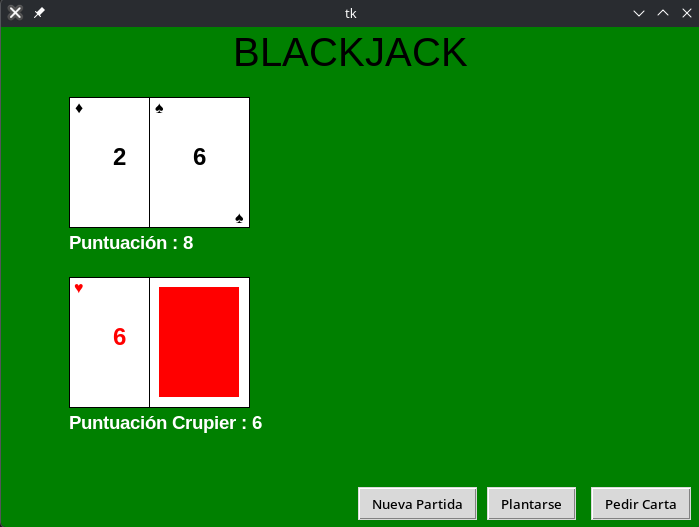
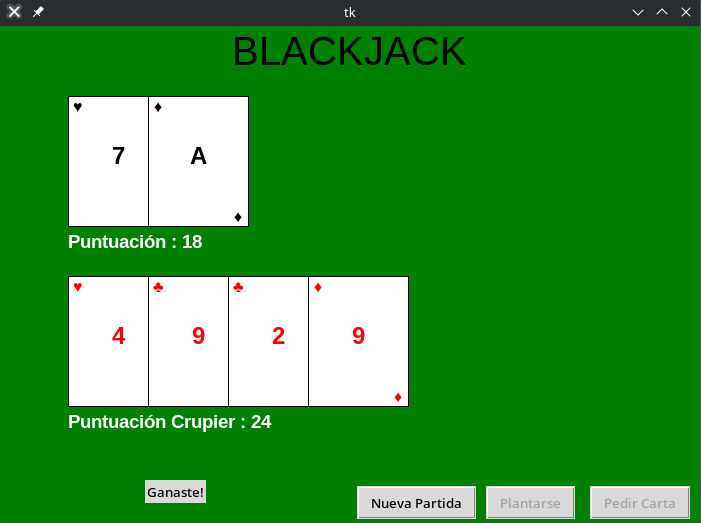
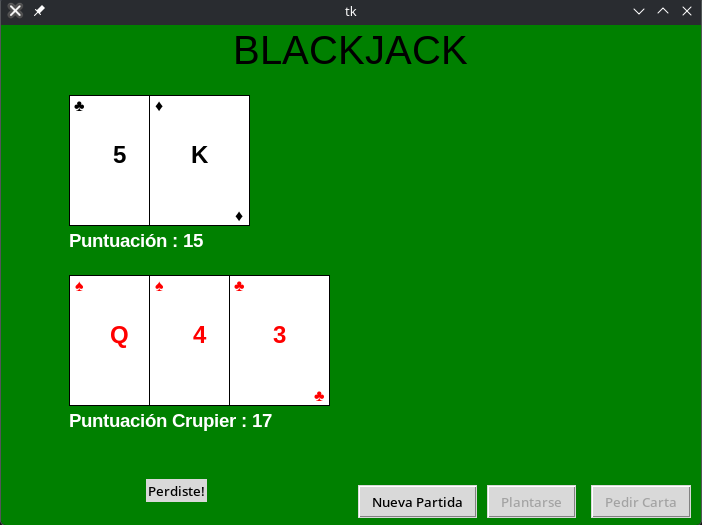

# Programa de juego BlackJack

Programa que simule al juego "BlackJack" utilizando python como lenguaje de programacion y tkinter para interfaz grafica

## Cotenido

| Programa/Carpeta | Funcion/Explicacion |
| ---------------- | ------------------- |
|/Docs | Documentacion del archivo BlackJack.py generado con pdoc|
|BlackJack.py | Archivo principal del programa, contiene toda la logica del BlackJack|
|/.atl | Carpeta de configuracion para pdoc|
|/_pycache_ | Carpetade configuracion para pdoc|


## Requisitos

version de python >= 3

pdoc en caso de necesitar generar documentación

## Como ejecutar el programa

Moverse a la carpeta del proyecto

``` bash
cd BlackJack
```

Utilizar el siguiente comando:

``` bash
python3 BlackJack.py
```

## Ejemplo de funcionamiento

Botones:

- Nueva Partida - Reiniciar la partida actual desde cero
- Plantarse - Terminar turno del jugador para comenzar el turno del crupier
- Pedir Carta - Obtener una carta nueva en tu baraja y sumar los puntos correspondientes de la carta nueva a tu puntaje



Ganar:

Obtienes la victoria en caso de plantarse antes de sobrepasar los 21 puntos



Perder:

Eres derrotado en caso de que te hayas plantado y el crupier haya superado tu puntuacion final



## Autor

Alejandro Gpe. Reyna Lujan


